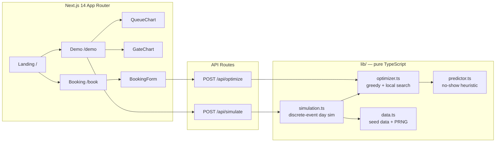

# TAS Casablanca — Truck Appointment System for the Port of Casablanca

[](https://nextjs.org/)
[](https://www.typescriptlang.org/)
[](#testing)
[](#license)

An interactive, deployment-ready demo of a **Truck Appointment System (TAS)** for the Port of Casablanca — the lever Moroccan press coverage and local research both point to as the #1 fix for the port's landside congestion crisis.

**Live demo:** https://tas-casablanca-eliem08s-projects.vercel.app

---

## The problem

The Port of Casablanca handles roughly **65% of Morocco's foreign trade**. In October 2026 it entered what port watchers called its worst landside congestion crisis on record:

| Indicator | Before | Crisis (Oct 2026) |
|---|---|---|
| Daily throughput | ~2,800 containers/day | ~800 containers/day (−70%) |
| Truck waiting time | normal | up to **12 hours** |
| Gates in operation | 3 | 3 (hard constraint) |
| Truck scheduling | chaotic, first-come-first-served | **no appointment system** |

Reported causes: traffic diverted from Tanger Med, record grain imports, importers leaving containers in the port ("squatting"), slow customs clearance, and total truck-arrival chaos with no slot discipline. Demurrage and storage fines pushed small importers toward bankruptcy.

> **Honesty note:** the crisis figures above come from Moroccan press and social-media coverage of October 2026, not from an audited port dataset. They are presented here as *reported* figures to motivate the demo.

## The evidence this demo is built on

A Moroccan research team (ENSEM Casablanca) modeled a **dynamic truck appointment system on real Casablanca port data** and reported:

- **−62%** maximum queue length
- **7.8%** of trucks rescheduled against their preferred time
- **−785 tonnes/year** of CO₂

> These are the researchers' reported results, summarized from secondary coverage. This repo does not re-implement their paper; it demonstrates the same *class* of system — slot optimization + no-show-aware overbooking — on simulated data.

## What this app does

- **Slot booking** (`/book`) — trucking companies request pickup/delivery windows; the optimizer assigns a gate + 30-minute slot, predicts no-show risk, and flags reschedules.
- **Optimization engine** (`lib/optimizer.ts`) — greedy assignment plus local-search improvement minimizing peak slot load, reschedules, and waiting time. A first-come-first-served baseline is computed for comparison.
- **No-show prediction** (`lib/predictor.ts`) — a transparent heuristic scoring function (lead time, driver history, night slots, cargo type) driving intelligent overbooking. **This is a heuristic, not the LSTM-Transformer arrival model from the literature** — the code and docs say so wherever it matters.
- **Live dashboard** (`/demo`) — queue-length curves (baseline vs optimized), gate utilization, reschedule rate, CO₂ estimate, and a TAS ON/OFF scenario toggle.
- **Marketing landing page** (`/`) — the pitch: problem, evidence, ROI.

## Architecture



All domain logic is pure, deterministic (seeded PRNG), and framework-free — it can be lifted into any backend.

## ROI — why a port authority buys this

Using the ENSEM-reported benchmarks as the reference case:

1. **Throughput recovery.** Appointments flatten the morning arrival spike that chokes 3 gates. The demo's simulated day shows peak queue collapsing when the optimizer spreads arrivals across all slots and gates.
2. **−62% max queue length** (ENSEM, real port data). Shorter queues = less gate idle/starve cycling = more containers per day without pouring concrete.
3. **−785 t CO₂/year** (ENSEM). Idling trucks burn ~2.5 L/h; a 12-hour wait is ~80 kg CO₂ per truck. The demo computes CO₂ from simulated waiting time so buyers see the green dividend live.
4. **Only 7.8% rescheduled** (ENSEM). The optimizer respects preferred windows; truckers keep their habits, the port keeps its flow.
5. **No-show-aware overbooking.** The predictor fills expected gaps instead of leaving paid gate capacity idle.

## Getting started

```bash
npm install
npm run dev      # http://localhost:3000
npm test         # vitest — optimizer, predictor, simulation
npm run build    # production build
```

Deploy: push to `main` — the Vercel project auto-deploys (or `vercel --prod`).

## API

### POST /api/optimize
Assign slots to booking requests.

```json
{
  "requests": [
    {
      "id": "req-1", "company": "Atlas Freight Maroc", "truckPlate": "48213 - A - 6",
      "cargo": "general", "move": "import", "containers": 1,
      "preferredStart": 420, "preferredEnd": 600,
      "leadTimeHours": 24, "driverNoShowRate": 0.05, "createdAt": 1
    }
  ]
}
```

Response: `{ assignments: [...], summary: { total, rescheduled, rescheduleRate, avgNoShowRisk } }`.

### POST /api/simulate
```json
{ "trucks": 220, "seed": 42 }
```
Response: `{ baseline: DayMetrics, optimized: DayMetrics, params }` — queue series, gate utilization, CO₂, waits.

`GET` on either route returns usage docs.

## Screenshots

Captured from the live demo at https://tas-casablanca-eliem08s-projects.vercel.app:

- `docs/screenshots/landing.png` — landing page hero with the crisis stat strip
- `docs/screenshots/demo-on.png` — dashboard with TAS ON: flattened queue curve, balanced gates, benchmark panel
- `docs/screenshots/demo-off.png` — dashboard with TAS OFF: the status-quo congestion spike
- `docs/screenshots/booking.png` — carrier booking form with live no-show risk meter

## Guided demo script (for a buyer meeting)

1. Open `/` — the landing page tells the crisis story in 60 seconds.
2. Go to `/demo` — toggle **TAS OFF**: red queue curve spikes to a midday wall; gates saturate; CO₂ climbs.
3. Toggle **TAS ON**: the teal curve flattens, utilization balances across 3 gates, reschedule rate stays single-digit.
4. Open `/book` — submit a booking as a trucking company; watch the optimizer place it, show no-show risk, and explain any reschedule.
5. Close with the ROI panel: 62% / 785t / 7.8% — the ENSEM numbers this demo is calibrated to echo.

## Honest limitations

- **All "live" numbers are simulated.** The dashboard runs a discrete-event simulation on synthetic demand, not on ANP or terminal operating data.
- **The predictor is a heuristic**, not a trained model. Real deployment needs historical gate logs to fit no-show models (the literature uses LSTM-Transformer architectures for arrival forecasting).
- **Single-instance in-memory demo.** No database, no auth, no real carrier integration — those are Phase-1 build items, listed in `docs/roadmap.md` (planned).
- Crisis figures are press-reported, not audited.

## Project structure

```
app/                # Next.js app router: / (landing), /demo, /book, /api/*
components/         # Nav, Footer, ui primitives, charts, BookingForm
lib/                # types, data, optimizer, predictor, simulation (pure TS)
tests/              # vitest suites for lib/
public/             # static assets
```

## Testing

```bash
npm test
```

Suites cover: optimizer feasibility (every request assigned, capacity respected, determinism, optimized ≤ baseline peak load), predictor monotonicity and bounds, simulation sanity (metrics in range, TAS improves on baseline for the reference seed).

## License

MIT.
