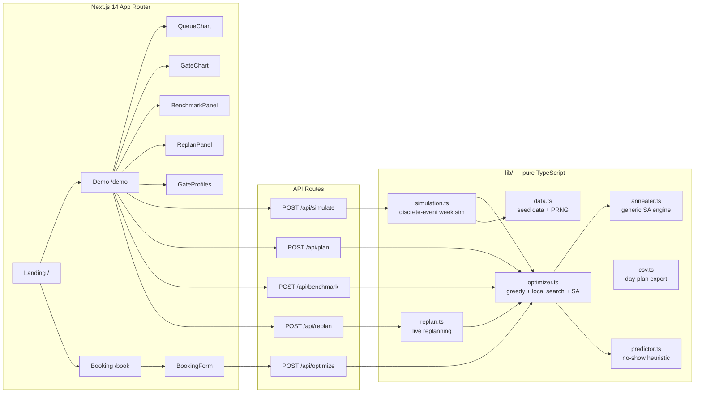

# TAS Casablanca — Truck Appointment System for the Port of Casablanca

[](https://nextjs.org/)
[](https://www.typescriptlang.org/)
[](#testing)
[](#license)

An interactive, deployment-ready demo of a **Truck Appointment System (TAS)** for the Port of Casablanca — the lever Moroccan press coverage and local research both point to as the #1 fix for the port's landside congestion crisis.

**Live demo:** https://tas-casablanca-eliem08s-projects.vercel.app

---

## The problem

The Port of Casablanca handles roughly **65% of Morocco's foreign trade**. In October 2026 it entered what port watchers called its worst landside congestion crisis on record:

| Indicator | Before | Crisis (Oct 2026) |
|---|---|---|
| Daily throughput | ~2,800 containers/day | ~800 containers/day (−70%) |
| Truck waiting time | normal | up to **12 hours** |
| Gates in operation | 3 | 3 (hard constraint) |
| Truck scheduling | chaotic, first-come-first-served | **no appointment system** |

Reported causes: traffic diverted from Tanger Med, record grain imports, importers leaving containers in the port ("squatting"), slow customs clearance, and total truck-arrival chaos with no slot discipline. Demurrage and storage fines pushed small importers toward bankruptcy.

> **Honesty note:** the crisis figures above come from Moroccan press and social-media coverage of October 2026, not from an audited port dataset. They are presented here as *reported* figures to motivate the demo.

## The evidence this demo is built on

A Moroccan research team (ENSEM Casablanca) modeled a **dynamic truck appointment system on real Casablanca port data** and reported:

- **−62%** maximum queue length
- **7.8%** of trucks rescheduled against their preferred time
- **−785 tonnes/year** of CO₂

> These are the researchers' reported results, summarized from secondary coverage. This repo does not re-implement their paper; it demonstrates the same *class* of system — slot optimization + no-show-aware overbooking — on simulated data.

## What this app does

- **Slot booking** (`/book`) — trucking companies pick a day in the 7-day rolling horizon and a terminal, then request pickup/delivery windows; the optimizer assigns a gate + 30-minute slot, predicts no-show risk, and flags reschedules.
- **Optimization engine** (`lib/optimizer.ts`) — greedy assignment plus local-search improvement, **upgraded with simulated annealing** (`lib/annealer.ts`) that provably never loses to greedy on the shared cost function. A first-come-first-served baseline is computed for comparison.
- **Multi-day rolling horizon** — bookings, optimization, and simulation all run across 7 days (`lib/data.ts` `generateWeekRequests`, `lib/optimizer.ts` `optimizeHorizon`, `lib/simulation.ts` `simulateWeek`). Days share no capacity — each day has its own slots — so the horizon plan is one optimized day-plan per day, plus week totals.
- **Live replanning** (`lib/replan.ts`) — the day is running and trucks go late or no-show: the dispatcher marks disruptions, confirmed slots freeze, and the rest of the day is re-optimized. The UI shows exactly what moved.
- **Per-gate service model** — gates are not interchangeable: Express (4 min/truck, 7 per slot), Standard (5 min, 6 per slot), Inspection (8 min, 3 per slot). The optimizer and the queue simulation both use these rates; bookings name a terminal and the optimizer prefers that terminal's gate.
- **CSV export** (`lib/csv.ts`) — download the day plan (slot, truck, gate, terminal, window, status) for dispatchers and TOS import.
- **No-show prediction** (`lib/predictor.ts`) — a transparent heuristic scoring function (lead time, driver history, night slots, cargo type) driving intelligent overbooking. **This is a heuristic, not the LSTM-Transformer arrival model from the literature** — the code and docs say so wherever it matters.
- **Live dashboard** (`/demo`) — day selector, optimizer-method toggle (greedy vs annealing), horizon totals, queue-length curves (baseline vs optimized), gate utilization, reschedule rate, CO₂ estimate, a TAS ON/OFF scenario toggle, a greedy-vs-annealing benchmark panel, the gate service model, and the live-replanning panel.
- **Marketing landing page** (`/`) — the pitch: problem, evidence, ROI.

## Algorithms

### Slot optimization — greedy + local search + simulated annealing

All three stages share one cost function (`totalCost` in `lib/optimizer.ts`):

```
cost = 10 × peak slot load + 3 × rescheduled + 2 × terminal mismatches + 0.5 × total wait
```

1. **Greedy:** earliest preferred start first; each truck takes the lowest-cost feasible gate/slot (load + reschedule penalty + terminal penalty), respecting per-gate capacity (and overbooking, when enabled).
2. **Local search:** 250 random single-truck reassignments, accepted only on strict cost improvement.
3. **Simulated annealing** (`lib/annealer.ts`, 2,500 moves, geometric cooling 6 → 0.02): random single-truck moves, uphill moves accepted with probability exp(−Δ/T). The best state seen is always kept — annealing starts from the greedy solution, so **it can never score worse than greedy** (asserted in `tests/annealer.test.ts`).

Per-gate capacity: a slot holds `floor(30 / serviceMin)` trucks — 7 express, 6 standard, 3 inspection. Overbooking inflates capacity by the expected no-show factor (capped at 2×).

### Live replanning (`lib/replan.ts`)

1. **Freeze** assignments whose slot starts before `now` — confirmed, never moved.
2. **Drop** no-shows — their slot is freed.
3. **Re-insert** late trucks with a window starting at `max(now, old slot + delay)` — never in the past.
4. **Re-optimize** the remaining unserved trucks with frozen slots as blocked capacity and an earliest-slot constraint at `now`.

The result reports moved trucks, freed slots, and before/after scores on the shared cost function.

### Queue simulation (`lib/simulation.ts`)

5-minute discrete-event steps, one FIFO queue per gate. Each gate serves at its own rate via a service-credit accumulator (credit grows by `5 / serviceMin` per step; a truck is served once credit ≥ 1). Baseline world: wide arrival jitter + 12% unannounced morning walk-ins. TAS world: tight arrivals around assigned slots, minus modeled no-shows.

### No-show heuristic (`lib/predictor.ts`)

Logistic-style hand-tuned score (lead time, driver history, night slots, cargo) — priors, not fitted parameters. See the file header for the honest methodology note.

## Architecture



All domain logic is pure, deterministic (seeded PRNG), and framework-free — it can be lifted into any backend.

## ROI — why a port authority buys this

Using the ENSEM-reported benchmarks as the reference case:

1. **Throughput recovery.** Appointments flatten the morning arrival spike that chokes 3 gates. The demo's simulated day shows peak queue collapsing when the optimizer spreads arrivals across all slots and gates.
2. **−62% max queue length** (ENSEM, real port data). Shorter queues = less gate idle/starve cycling = more containers per day without pouring concrete.
3. **−785 t CO₂/year** (ENSEM). Idling trucks burn ~2.5 L/h; a 12-hour wait is ~80 kg CO₂ per truck. The demo computes CO₂ from simulated waiting time so buyers see the green dividend live.
4. **Only 7.8% rescheduled** (ENSEM). The optimizer respects preferred windows; truckers keep their habits, the port keeps its flow.
5. **No-show-aware overbooking.** The predictor fills expected gaps instead of leaving paid gate capacity idle.

## Getting started

```bash
npm install
npm run dev      # http://localhost:3000
npm test         # vitest — optimizer, predictor, simulation
npm run build    # production build
```

Deploy: push to `main` — the Vercel project auto-deploys (or `vercel --prod`).

## API

### POST /api/optimize
Assign slots to booking requests.

```json
{
  "requests": [
    {
      "id": "req-1", "company": "Atlas Freight Maroc", "truckPlate": "48213 - A - 6",
      "cargo": "general", "move": "import", "containers": 1,
      "preferredStart": 420, "preferredEnd": 600,
      "leadTimeHours": 24, "driverNoShowRate": 0.05, "createdAt": 1
    }
  ]
}
```

Response: `{ assignments: [...], method, summary: { total, rescheduled, rescheduleRate, avgNoShowRisk, optimizerCost, avgWaitMin, maxSlotLoad } }`.

Optional body field `method: "greedy" | "annealed"` selects the optimizer. Optional per-request fields: `day` (0..6, default 0), `terminal` (T1|T2|T3|any). All requests in one call must share the same day.

### POST /api/simulate
```json
{ "trucks": 220, "seed": 42, "days": 7, "method": "greedy" }
```
`days=1` (default) returns `{ baseline: DayMetrics, optimized: DayMetrics, params }` — queue series, gate utilization, CO₂, waits. `days=2..7` returns `{ days: ScenarioResult[], horizon: HorizonSummary }` with week totals. `method` selects the optimizer for the optimized world.

### POST /api/plan
```json
{ "trucks": 220, "seed": 42, "day": 0, "method": "greedy" }
```
Response: `{ day, method, requests, assignments, summary }` — the actual optimized plan for one horizon day. Powers the demo's replanning panel and CSV export.

### POST /api/benchmark
```json
{ "trucks": 220, "seed": 42, "day": 0 }
```
Response: `{ day, trucks, seed, greedy: {...}, annealed: {...}, delta: {...} }` — both optimizers on identical demand, with cost, avg wait, reschedules, peak slot load, and CO₂ for each.

### POST /api/replan
```json
{
  "requests": [ ... ],
  "assignments": [ ... ],
  "disruptions": [{ "requestId": "REQ-0001", "kind": "late", "lateByMin": 60 }],
  "nowMin": 600,
  "method": "greedy"
}
```
Response: `{ after, before, moved, removedNoShows, lateReplaced, frozen, beforeScore, afterScore }`.

`GET` on any route returns usage docs.

## Screenshots

Captured from the live demo at https://tas-casablanca-eliem08s-projects.vercel.app:

- `docs/screenshots/landing.jpg` — landing page hero with the crisis stat strip
- `docs/screenshots/demo-on.jpg` — dashboard with TAS ON: flattened queue curve, balanced gates, benchmark panel
- `docs/screenshots/demo-off.jpg` — dashboard with TAS OFF: the status-quo congestion spike
- `docs/screenshots/booking.jpg` — carrier booking form with live no-show risk meter

## Guided demo script (for a buyer meeting)

1. Open `/` — the landing page tells the crisis story in 60 seconds.
2. Go to `/demo` — toggle **TAS OFF**: red queue curve spikes to a midday wall; gates saturate; CO₂ climbs.
3. Toggle **TAS ON**: the teal curve flattens, utilization balances across 3 gates, reschedule rate stays single-digit.
4. Switch **Day 1 → Day 7**: the horizon totals update; each day has its own demand and plan.
5. Toggle **Greedy → Sim. annealing**: the benchmark panel shows annealing's improvement on identical demand — never worse, usually better.
6. **Live replanning**: set "now" to 10:00, mark a truck late +60 min, hit Re-optimize — watch the plan absorb the disruption without touching confirmed slots.
7. **Export CSV**: download the day plan for dispatchers.
8. Open `/book` — submit a booking as a trucking company on a chosen day/terminal; watch the optimizer place it, show no-show risk, and explain any reschedule.
9. Close with the ROI panel: 62% / 785t / 7.8% — the ENSEM numbers this demo is calibrated to echo.

## Honest limitations

- **All "live" numbers are simulated.** The dashboard runs a discrete-event simulation on synthetic demand, not on ANP or terminal operating data.
- **Days are independent.** The horizon has no cross-day carryover — a truck that misses its day does not roll into the next day's plan. Real operations would need a carryover rule.
- **Simulated annealing is a heuristic**, not a proof of optimality. It never loses to greedy on the shared cost function, but neither method certifies a global optimum.
- **Replanning is a same-day heuristic.** Frozen slots are never revisited, so a replan can be locally optimal at best; a full-day re-optimization from scratch could theoretically do better (at the cost of disrupting confirmed trucks).
- **The predictor is a heuristic**, not a trained model. Real deployment needs historical gate logs to fit no-show models (the literature uses LSTM-Transformer architectures for arrival forecasting).
- **Single-instance in-memory demo.** No database, no auth, no real carrier integration — those are Phase-1 build items, listed in `docs/roadmap.md` (planned).
- Crisis figures are press-reported, not audited.

## Project structure

```
app/                # Next.js app router: / (landing), /demo, /book, /api/*
components/         # Nav, Footer, ui primitives, charts, BookingForm,
                    # BenchmarkPanel, ReplanPanel, GateProfiles
lib/                # types, data, optimizer, annealer, replan, csv,
                    # predictor, simulation (pure TS)
tests/              # vitest suites for lib/
public/             # static assets
```

## Testing

```bash
npm test
```

Suites cover: optimizer feasibility (every request assigned, per-gate capacity respected, determinism, optimized ≤ baseline peak load, terminal preference, horizon day), annealing (beats-or-matches greedy on cost, determinism, capacity), replanning (confirmed slots frozen, no-show frees slot, late re-placement, no placements in the past, determinism), CSV (header, row count, quoting, slot geometry, status values), horizon (7-day coverage, per-day capacity, week aggregation, determinism), predictor monotonicity and bounds, simulation sanity (metrics in range, TAS improves on baseline for the reference seed).

## License

MIT.
